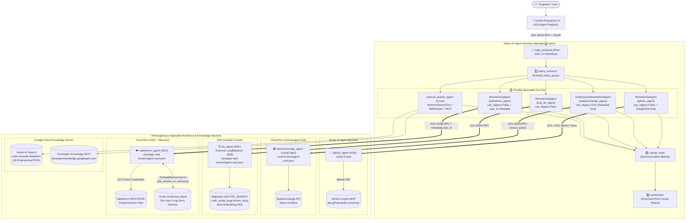
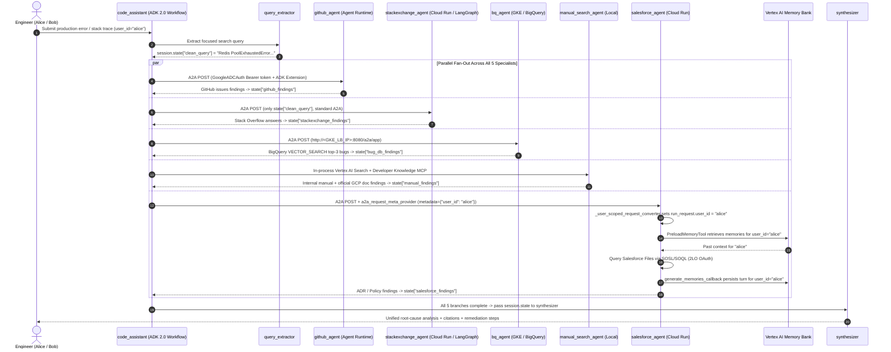
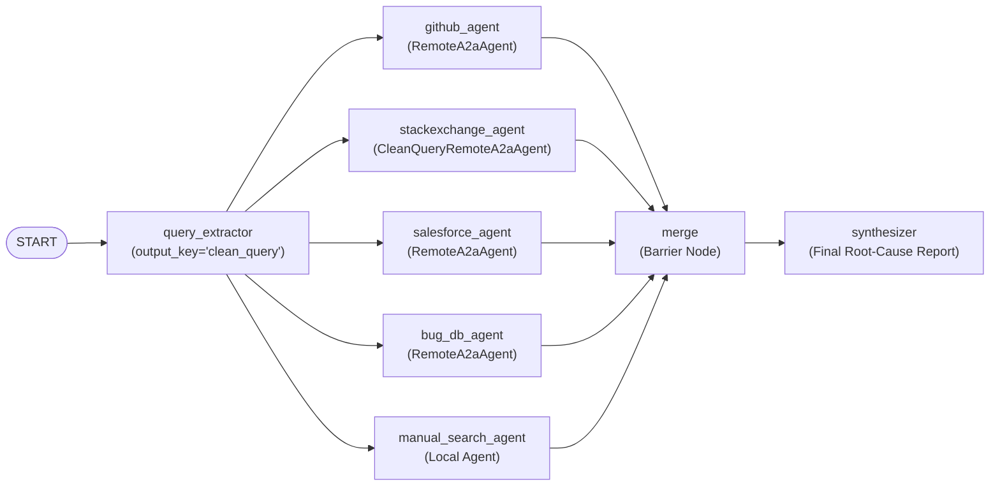
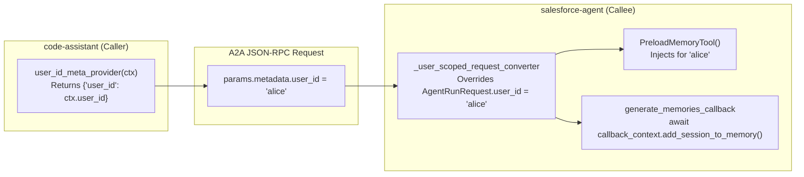

# [FDE] Build Enterprise Agents — Challenge Lab Reference & Architecture Guide

[](https://cloud.google.com/vertex-ai)
[](https://google.github.io/adk-docs/)
[_v1.0_%26_v0.3-FBBC04)](https://google.github.io/A2A/)
[](https://cloud.google.com/vertex-ai/generative-ai/docs)
[-brightgreen)](#verification--unit-test-suite)

> **Industry-Standard Documentation & Complete Reference Implementation** for the **Build Enterprise Agents** Challenge Lab. This repository contains the complete, tested source code for all five agents (`github-agent`, `stackexchange-agent`, `bq-agent`, `code-assistant`, and `salesforce-agent`), the lab datasets (`known_bugs.json`, `code_manuals/`, `Salesforce_documents/`), and a crystal-clear, end-to-end engineering walkthrough.

---

## Table of Contents

1. [Overview](#overview)
2. [System Architecture & Diagrams](#system-architecture--diagrams)
3. [Objectives](#objectives)
4. [Repository Structure](#repository-structure)
5. [Setup and Requirements](#setup-and-requirements)
6. [Prerequisites (GitHub PAT & Salesforce Developer Edition)](#prerequisites)
7. [Core Architectural Concepts](#core-architectural-concepts)
   - [Heterogeneous Agents and the A2A Protocol](#heterogeneous-agents-and-the-a2a-protocol)
   - [Authentication Across Runtimes](#authentication-across-runtimes)
8. [Step-by-Step Implementation Guide](#step-by-step-implementation-guide)
   - [Task 1: Deploy the GitHub Agent to Agent Runtime](#task-1-deploy-the-github-agent-to-agent-runtime)
   - [Task 2: Deploy the StackExchange Agent to Cloud Run](#task-2-deploy-the-stackexchange-agent-to-cloud-run)
   - [Task 3: Create the BigQuery Dataset for the Bug Agent](#task-3-create-the-bigquery-dataset-for-the-bug-agent)
   - [Task 4: Generate and Deploy the BigQuery Agent to GKE](#task-4-generate-and-deploy-the-bigquery-agent-to-gke)
   - [Task 5: Orchestrate the Root Code Assist Agent](#task-5-orchestrate-the-root-code-assist-agent)
   - [Task 6: Deploy the Root Agent and Register in Gemini Enterprise](#task-6-deploy-the-root-agent-and-register-in-gemini-enterprise)
   - [Task 7: Extend the System with the Salesforce Agent](#task-7-extend-the-system-with-the-salesforce-agent)
   - [Task 8: Add Long-Term Memory with Vertex AI Memory Bank](#task-8-add-long-term-memory-with-vertex-ai-memory-bank)
9. [Verification & Unit Test Suite](#verification--unit-test-suite)
10. [Troubleshooting & Operational Reference](#troubleshooting--operational-reference)

---

## Overview

In this lab, you build **Code Assist**, an internal system that researches production errors for engineers. It is a **heterogeneous multi-agent system**: its specialist agents are written in different frameworks and run on different Google Cloud runtimes, yet they cooperate as one system by speaking the **Agent2Agent (A2A)** protocol.

You build the system up one specialist at a time, and the story gets easier at each step:

1. You start with the **Agent Development Kit (ADK)** and see how quickly `agents-cli` deploys an agent to **Agent Runtime**.
2. You learn that **any framework works over A2A** by deploying a **LangGraph** agent to **Cloud Run**.
3. You go faster still with **vibecoding**: you generate a **BigQuery vector-search agent** from a prompt using the **Antigravity** coding agent, then deploy it to **GKE**.
4. You compose the specialists as **A2A nodes in an ADK 2.0 graph workflow**, and test the whole system locally.
5. You deploy the root to **Agent Runtime** and register it in **Gemini Enterprise**.
6. You extend the running system with one more specialist (**Salesforce Agent** with **Vertex AI Memory Bank**).

### The Specialists

| Agent | Framework | Runtime | How you build it |
| :--- | :--- | :--- | :--- |
| **`github_agent`** | ADK + MCP | **Agent Runtime** (Vertex AI Agent Engine) | Configure `McpToolset` + `agents-cli deploy` |
| **`stackexchange_agent`** | LangGraph + `a2a-sdk` | **Cloud Run** | Build container image + `gcloud run deploy` |
| **`bq-agent`** | ADK + BigQuery Vector Search | **GKE Autopilot** | Generate with Antigravity + `agents-cli deploy` |
| **`manual_search`** | Local ADK tools | **Agent Runtime** (inside root) | Vertex AI Search datastore + official Google docs (Developer Knowledge MCP, via a Skill Registry skill) |
| **`salesforce_agent`** | ADK + Salesforce REST/SOSL + Memory Bank | **Cloud Run** | Configure OAuth 2LO & Memory Bank + `agents-cli deploy` |
| **`code_assistant` (root)** | ADK 2.0 `Workflow` | **Agent Runtime** (Vertex AI Agent Engine) | Orchestrate parallel A2A fan-out/fan-in + `agents-cli deploy` |

> [!NOTE]
> This is an advanced lab. It assumes you are comfortable with Python, `gcloud`, containers, and the basics of ADK and multi-agent systems. The default model across all agents is **`gemini-3.5-flash`**.

---

## System Architecture & Diagrams

### High-Level Multi-Agent System Architecture



### End-to-End Request & Per-User Memory Sequence



---

## Objectives

In this lab, you learn how to perform the following tasks:

- **Configure and deploy ADK agents** to **Agent Runtime**, **Cloud Run**, and **GKE** with `agents-cli`.
- **Make agents from different frameworks interoperate** over the **A2A protocol** (connecting ADK 2.0 and LangGraph seamlessly).
- **Generate a working agent from a prompt** with the **Antigravity** coding agent (`bq-agent` with BigQuery `VECTOR_SEARCH`).
- **Orchestrate specialists as A2A nodes** in an **ADK 2.0 graph workflow** (`Workflow` with parallel fan-out and a synchronization barrier) and register the system in **Gemini Enterprise**.
- **Give an agent long-term, per-user memory** with **Vertex AI Memory Bank** (`VertexAiMemoryBankService`, `PreloadMemoryTool`, and A2A `user_id` metadata propagation).

---

## Repository Structure

```text
.
├── README.md                                  # Complete architectural guide & step-by-step walkthrough
├── known_bugs.json                            # 30 pre-embedded historical bug records for BigQuery (Task 3)
├── code_manuals/                              # 16 internal engineering handbook PDFs for Vertex AI Search (Task 5)
├── Salesforce_documents.zip                   # Archive of 12 ADR & Policy .docx files for Salesforce Files
├── Salesforce_documents/                      # Extracted 12 ADR & Policy .docx files (Prerequisites / Task 7)
└── agents/
    ├── github-agent/                          # Task 1: ADK + GitHub MCP specialist -> Agent Runtime
    │   ├── app/
    │   │   ├── agent.py                       # McpToolset + StreamableHTTPConnectionParams + tool_filter
    │   │   ├── fast_api_app.py                # FastAPI + A2A entrypoint
    │   │   └── app_utils/a2a.py               # Dynamic AgentCard + v0.3 compatibility
    │   └── tests/unit/test_agent_config.py    # 5 unit tests
    ├── stackexchange-agent/                   # Task 2: LangGraph + a2a-sdk specialist -> Cloud Run
    │   ├── Dockerfile                         # Container image definition (port 8080)
    │   ├── app/
    │   │   ├── agent.py                       # LangGraph StateGraph (START -> search -> END)
    │   │   ├── a2a_executor.py                # LangGraphAgentExecutor bridging LangGraph to a2a-sdk
    │   │   └── server.py                      # Starlette A2A server advertising v1.0 & v0.3 interfaces
    │   └── tests/unit/                        # 7 unit tests
    ├── bq-agent/                              # Task 4: ADK + BigQuery VECTOR_SEARCH specialist -> GKE
    │   ├── app/
    │   │   ├── agent.py                       # Root bq_agent definition with grounded instructions
    │   │   ├── tools.py                       # find_similar_bugs (text-embedding-004 + VECTOR_SEARCH)
    │   │   └── fast_api_app.py                # FastAPI + A2A route attachment
    │   ├── deployment/terraform/single-project/
    │   │   ├── service.tf                     # External GKE LoadBalancer + APP_URL & MODEL env vars
    │   │   ├── variables.tf                   # Includes roles/bigquery.jobUser & roles/bigquery.dataViewer
    │   │   └── service_outputs.tf             # Outputs cluster endpoint & external LoadBalancer IP
    │   └── tests/unit/test_bq_agent.py        # 6 unit tests
    ├── code-assistant/                        # Tasks 5 & 6: Root ADK 2.0 Workflow Orchestrator -> Agent Runtime
    │   ├── app/
    │   │   ├── agent.py                       # ADK 2.0 Workflow graph (fan-out to 5 specialists -> merge -> synthesizer)
    │   │   ├── auth.py                        # GoogleADCAuth (httpx.Auth) injecting OAuth Bearer tokens
    │   │   ├── callbacks.py                   # capture_response_to_state after-agent callback factory
    │   │   ├── skills/                        # Skill Registry skill for Developer Knowledge MCP
    │   │   └── app_utils/
    │   │       ├── a2a.py                     # user_id_meta_provider + A2A route attachment
    │   │       └── clean_query_a2a.py         # CleanQueryRemoteA2aAgent sending only state["clean_query"]
    │   └── tests/unit/                        # 10 unit tests
    └── salesforce-agent/                      # Tasks 7 & 8: ADK + Salesforce 2LO + Vertex AI Memory Bank -> Cloud Run
        ├── app/
        │   ├── agent.py                       # PreloadMemoryTool + generate_memories_callback + search_salesforce
        │   ├── salesforce_client.py           # OAuth 2.0 client_credentials flow + SOSL/SOQL queries
        │   └── app_utils/
        │       ├── a2a.py                     # _user_scoped_request_converter extracting metadata["user_id"]
        │       └── services.py                # VertexAiMemoryBankService configuration
        ├── scripts/
        │   └── create_memory_bank.py          # Idempotent provisioning script for Vertex AI Memory Bank
        └── tests/unit/                        # 28 unit tests
```

---

## Setup and Requirements

### Before you click the Start Lab button

Read these instructions. Labs are timed and you cannot pause them. The timer, which starts when you click **Start Lab**, shows how long Google Cloud resources are made available to you.

This hands-on lab lets you do the lab activities in a real cloud environment, not in a simulation or demo environment. It does so by giving you new, temporary credentials you use to sign in and access Google Cloud for the duration of the lab.

To complete this lab, you need:

- Access to a standard internet browser (Chrome browser recommended).
  > [!NOTE]
  > Use an Incognito (recommended) or private browser window to run this lab. This prevents conflicts between your personal account and the student account, which may cause extra charges incurred to your personal account.
- Time to complete the lab—remember, once you start, you cannot pause a lab.
  > [!IMPORTANT]
  > Use only the student account for this lab. If you use a different Google Cloud account, you may incur charges to that account.

### How to start your lab and sign in to the Google Cloud console

1. Click the **Start Lab** button. If you need to pay for the lab, a dialog opens for you to select your payment method. On the right is the **Lab setup** pane with the following:
   - The **Open Google Cloud console** button
   - The temporary credentials that you must use for this lab
   - Other information, if needed, to step through this lab
2. In the **Lab Setup** section, right-click **Open Google Cloud console** and select **Open link in new window** (or alternatively right-click and select **Open Link in Incognito Window** if you are running the Chrome browser).
   The lab spins up resources, and then opens another tab that shows the **Sign in** page.
   *Tip: Arrange the tabs in separate windows, side-by-side.*
3. If you see the **Choose an account** dialog, click **Use Another Account**.
4. Copy the **Username** from the Lab Setup pane and paste it into the **Sign in** dialog, then click **Next**.
5. Copy the **Password** from the Lab Setup pane and paste it into the **Welcome** dialog, then click **Next**.
6. Click through the subsequent pages:
   - Accept the terms and conditions.
   - Do not add recovery options or two-factor authentication (because this is a temporary account).
   - Do not sign up for free trials.

After a few moments, the Google Cloud console opens in this tab.

---

## Prerequisites

The Salesforce agent you build in Task 7 searches an organization's document library, which you host in **Salesforce Files**. Before you start the lab, create a free **Salesforce Developer Edition** account and upload the lab's documents to it.

> [!IMPORTANT]
> **Do this ahead of time.** Salesforce sends a verification email and takes a few minutes to provision your org, so complete these steps before your lab session where possible.
>
> **Save your third-party credentials in a persistent local location.** This lab interacts with external third-party platforms. If you plan to complete the related labs (*Agent Identity Foundations* and *Observe and Secure a Multi-Agent System*), you will reuse the same third-party credentials across those sessions:
> - **GitHub**: Personal Access Token (classic) with `repo` and `read:org` scopes
> - **Salesforce**: Connected App Consumer Key (`Client ID`)
> - **Salesforce**: Connected App Consumer Secret (`Client Secret`)
> - **Salesforce**: My Domain URL (e.g., `orgfarm-xxxx-dev-ed.develop.my.salesforce.com`)

### Access the Remote Browser (optional)

If corporate network, browser, or device security policies restrict downloading or uploading external files on your local workstation, you can use the pre-provisioned sandboxed **Remote Browser** session:

1. Open the Remote Browser session URL provided in your lab instructions in a new browser tab.
2. Open the Chrome browser inside the remote session and navigate to the [Salesforce Developer Edition signup page](https://developer.salesforce.com/signup).
3. Complete the Salesforce signup and document upload steps below inside this remote browser session without downloading files to your local workstation.

### Create a Salesforce Developer Edition account

A Developer Edition org is a free, full-featured Salesforce environment. You use it to host the documents the Salesforce agent searches.

1. Open the [Salesforce Developer signup page](https://developer.salesforce.com/signup) in your browser (or inside the Remote Browser session).
2. Complete the signup form with your details, then select **Sign me up**.
3. Review and accept the Master Subscription Agreement and Terms of Use.
4. Open the activation email from Salesforce (subject *"Welcome to Salesforce: Verify your account"*) and select **Verify Account**.
5. Set a password that meets the Salesforce requirements (at least 8 characters, with one letter and one number), choose a security question, then select **Change Password**.

You are now signed in to your Developer Edition org.

### Upload the documents to Salesforce Files

Next, copy the lab's documents from Cloud Storage and upload them to **Salesforce Files** so the Salesforce agent can find them.

> [!TIP]
> **Remote Browser tip:** If you are using the Remote Browser session, the Salesforce documents are already extracted directly on the Desktop. You can skip steps 1–3 and upload the files directly from the Desktop. Also, in this repository, the extracted `.docx` files are directly available under [`Salesforce_documents/`](Salesforce_documents/).

1. In Cloud Shell, copy the ZIP file from the Cloud Storage bucket:
   ```bash
   gcloud storage cp gs://l400-academy-data-science/l400-apex-001/Salesforce_documents.zip .
   ```
2. Download the ZIP file (using the Cloud Shell Editor right-click menu or **More (⋮) > Download**).
3. Extract the documents on your machine (12 `.docx` Architecture Decision Records and Engineering Policies):
   - `ADR-007_ mTLS Between Internal Services.docx`
   - `ADR-011_ API Versioning & Error Contract.docx`
   - `ADR-014_ Async I_O & Timeout Standards.docx`
   - `ADR-018_ Pub_Sub Delivery & Idempotency Standard.docx`
   - `ADR-021_ Standard Retry & Backoff Library.docx`
   - `ADR-025_ Container Base Images & Supply Chain.docx`
   - `ADR-030_ Structured Logging Standard.docx`
   - `Policy_ Authentication & Token Lifetime Standard.docx`
   - `Policy_ Database Connection Pooling & Limits.docx`
   - `Policy_ PII Handling in Logs (Data Governance).docx`
   - `Policy_ Resource Requests, Limits & Autoscaling.docx`
   - `Policy_ Secret Management via Secret Manager.docx`
4. In your Salesforce org, open the **App Launcher (⋮⋮⋮)**, search for `Files`, and select **Files**.
5. Select **Upload Files**, then select all 12 documents.

> [!NOTE]
> Confirm every document appears in Salesforce Files before you continue. Salesforce indexes uploaded files for search asynchronously, so allow a few minutes before the agent can find them.

---

## Core Architectural Concepts

### Heterogeneous Agents and the A2A Protocol

Real enterprises don't build every agent the same way. One team ships an ADK agent, another already has a LangGraph service, a third wants a managed runtime, and a fourth needs Kubernetes. A useful platform lets those agents cooperate without forcing everyone onto one framework or one runtime. That is what this lab demonstrates, and the **Agent2Agent (A2A)** protocol is what makes it possible.

A2A gives every agent a common contract, regardless of how it is built:

- **Agent Card**: A small JSON document at a well-known path (`/.well-known/agent-card.json` or `/a2a/app/.well-known/agent-card.json`) that describes the agent's skills, capabilities, protocol versions, and JSON-RPC endpoint URL. A caller reads the card, then sends messages to the endpoint. The caller never needs to know the callee's framework.
- **Transport**: The actual calls use **JSON-RPC over HTTP**. Because the contract is HTTP + JSON, an ADK agent, a LangGraph server, and a managed engine all look the same to a caller.

#### Key A2A Variations You Meet in This Lab

1. **The ADK A2A Extension (`use_legacy=False` vs `use_legacy=True`)**:
   - When an ADK agent calls another **ADK agent**, it can opt into a richer executor protocol (`use_legacy=False` on `RemoteA2aAgent`, paired with `force_new_version=True` on the server's `A2aAgentExecutor` and advertised via the extension URI `https://google.github.io/adk-docs/a2a/a2a-extension/`).
   - When an ADK agent calls a **non-ADK agent** (such as our LangGraph `stackexchange_agent`), it uses standard A2A (`use_legacy=True`, the default). Both travel over the same HTTP + JSON-RPC transport.
2. **Protocol Versions (`1.0` and `0.3` Dual Interface Pattern)**:
   - A2A is evolving from `0.3` to `1.x`. The `a2a-sdk` (`>= 1.0`) speaks `1.0` by default, while **Gemini Enterprise's registration validator** still checks for a `0.3` interface entry in `supported_interfaces`.
   - The agents in this lab advertise **both** `1.0` and `0.3` in `supported_interfaces` and enable `enable_v0_3_compat=True` on the JSON-RPC route handler so any caller (`1.0` or `0.3`) can talk to them seamlessly.
3. **Serving Styles Across Runtimes**:
   - **Agent Runtime** (Vertex AI Agent Engine) is a managed runtime: it hosts the ADK `App` directly and exposes its own built-in A2A surface at `/a2a/v1/card`.
   - **Cloud Run** and **GKE** run your container: a FastAPI (or Starlette) server mounts the A2A routes with `a2a-sdk` (`attach_a2a_routes`).

---

### Authentication Across Runtimes

How a caller authenticates to an A2A endpoint depends on where the agent runs:

| Runtime | Ingress Auth | How Callers Authenticate |
| :--- | :--- | :--- |
| **Agent Runtime** (Vertex AI) | Google Cloud IAM (`aiplatform.googleapis.com`) | Callers attach an **OAuth 2.0 access token** (`Authorization: Bearer <access_token>`) from Application Default Credentials (ADC) via `GoogleADCAuth`, and need `roles/aiplatform.user` on the project. |
| **Cloud Run** (in this lab) | `--allow-unauthenticated` (Public HTTPS) | Focuses on A2A protocol interoperability. In production, deploy with `--no-allow-unauthenticated`, grant `roles/run.invoker`, and attach an **OIDC ID token** whose `aud` claim is the Cloud Run service URL. |
| **GKE** (in this lab) | External Kubernetes `LoadBalancer` | Exposes port `8080` so Agent Runtime (which runs outside your VPC) can reach `bq-agent`. |

> [!TIP]
> **Production Security with Agent Gateway**:
> In production enterprise environments, **Agent Gateway** replaces per-runtime auth wiring (and public endpoints) with a single managed ingress and egress layer across Agent Runtime, Cloud Run, and GKE:
> - Every agent receives a cryptographic **Agent Identity** (**SPIFFE ID**), and agent-to-agent calls use **mTLS** or **OAuth with DPoP** (Demonstration of Proof-of-Possession) so tokens are bound to the calling agent's key pair.
> - Authorization is enforced per caller and per target with IAM (`roles/iap.egressor`) instead of network location or shared service accounts.
> - Every A2A and MCP call is centrally logged and traced.

---

## Step-by-Step Implementation Guide

### Environment Setup (Cloud Shell)

Before starting Task 1, download the lab assets into Cloud Shell and configure your environment variables:

```bash
gcloud config set project qwiklabs-gcp-04-d1a7a92a5c82
gcloud storage cp -r gs://qwiklabs-gcp-04-d1a7a92a5c82-bucket/* ~/
gcloud storage cp -r gs://qwiklabs-gcp-04-d1a7a92a5c82-bucket/.vscode ~/

export PROJECT_ID=$(gcloud config get-value project)
export PROJECT_NUMBER=$(gcloud projects describe "$PROJECT_ID" --format='value(projectNumber)')
export REGION=us-central1
```

Install **`agents-cli`** (the CLI from the Agent Starter Pack that scaffolds and deploys ADK agents across Agent Runtime, Cloud Run, and GKE):

```bash
uv tool install google-agents-cli
export PATH="$HOME/.local/bin:$PATH"
agents-cli --version
```

---

### Task 1: Deploy the GitHub Agent to Agent Runtime

The first specialist (`github_agent`) searches GitHub repositories and issues to find bug reports and upstream fixes related to an error. It is an **ADK agent** that connects to GitHub's hosted **Model Context Protocol (MCP)** server (`https://api.githubcopilot.com/mcp/`) and runs on **Vertex AI Agent Runtime**.

#### 1.1 How `github_agent` Works

In [`agents/github-agent/app/agent.py`](agents/github-agent/app/agent.py), we configure an ADK `McpToolset` using `StreamableHTTPConnectionParams`:

- **Endpoint**: `GITHUB_MCP_URL` (`https://api.githubcopilot.com/mcp/`)
- **Authentication**: Bearer token header (`Authorization: Bearer <GITHUB_TOKEN>`)
- **Least-Privilege Tool Filtering**: The GitHub MCP server exposes dozens of read/write tools (creating issues, opening PRs, pushing commits). Because an error-research specialist only needs read access, we pass `tool_filter=GITHUB_TOOL_FILTER` (`["search_repositories", "search_issues", "list_issues"]`) so the agent cannot mutate any repository state.

#### 1.2 Implementation: `agents/github-agent/app/agent.py`

```python
import os
from dotenv import load_dotenv
from google.adk.agents import Agent
from google.adk.apps import App
from google.adk.models import Gemini
from google.adk.tools.mcp_tool import McpToolset, StreamableHTTPConnectionParams
from google.genai import types

load_dotenv()

MODEL = os.getenv("MODEL", "gemini-3.5-flash")

GITHUB_MCP_URL = os.getenv("GITHUB_MCP_URL", "https://api.githubcopilot.com/mcp/")
GITHUB_TOKEN = os.getenv("GITHUB_TOKEN", "")

# Read-only subset of the GitHub MCP server's tools so this sub-agent cannot
# mutate repository state.
GITHUB_TOOL_FILTER = [
    "search_repositories",
    "search_issues",
    "list_issues",
]

github_mcp_toolset = McpToolset(
    connection_params=StreamableHTTPConnectionParams(
        url=GITHUB_MCP_URL,
        headers={"Authorization": f"Bearer {GITHUB_TOKEN}"},
    ),
    tool_filter=GITHUB_TOOL_FILTER,
)

root_agent = Agent(
    name="github_agent",
    description=(
        "Searches GitHub repositories and issues to find relevant code, bug "
        "reports, and discussions."
    ),
    model=Gemini(
        model=MODEL,
        retry_options=types.HttpRetryOptions(attempts=3),
    ),
    instruction=(
        "You are a GitHub research specialist. Use the GitHub MCP tools to "
        "search repositories and issues for relevant bug reports, error "
        "messages, and code discussions. Summarize findings clearly with "
        "repository names, issue numbers, and links when available."
    ),
    tools=[github_mcp_toolset],
)

app = App(
    root_agent=root_agent,
    name="app",
)
```

#### 1.3 Configure `.env`, Test, and Deploy to Agent Runtime

1. Create `~/agents/github-agent/.env`:
   ```bash
   cat <<EOF > ~/agents/github-agent/.env
   GOOGLE_CLOUD_PROJECT=$PROJECT_ID
   GOOGLE_CLOUD_LOCATION=global
   GOOGLE_GENAI_USE_VERTEXAI=TRUE
   GITHUB_TOKEN=<YOUR_GITHUB_PAT>
   EOF
   ```
2. Run the unit tests to verify the MCP toolset configuration:
   ```bash
   cd ~/agents/github-agent
   uv run pytest tests/unit
   ```
3. Deploy to **Vertex AI Agent Runtime** using `agents-cli`:
   ```bash
   cd ~/agents/github-agent
   agents-cli deploy \
     --project "$PROJECT_ID" \
     --region "$REGION" \
     --env-file .env \
     --auto-approve
   ```
   > [!NOTE]
   > `agents-cli deploy` runs Terraform under `deployment/terraform/single-project` (provisioning the application service account, IAM bindings, and telemetry bucket) and then packages the Python source and creates/updates the **Vertex AI Agent Engine** resource.
4. Record the deployed **Agent Engine resource ID** and construct its A2A Agent Card URL:
   ```bash
   export GITHUB_ENGINE_ID=<YOUR_GITHUB_ENGINE_ID>
   export GITHUB_AGENT_CARD_URL="https://${REGION}-aiplatform.googleapis.com/v1beta1/projects/${PROJECT_NUMBER}/locations/${REGION}/reasoningEngines/${GITHUB_ENGINE_ID}/a2a/v1/card"
   ```
5. Verify the live Agent Card using an OAuth Bearer token:
   ```bash
   curl -s -H "Authorization: Bearer $(gcloud auth print-access-token)" \
     "$GITHUB_AGENT_CARD_URL" | jq .
   ```

---

### Task 2: Deploy the StackExchange Agent to Cloud Run

To prove that **A2A is completely framework-agnostic**, the second specialist (`stackexchange_agent`) is written in **LangGraph** (not ADK!) and deployed as a container on **Cloud Run**. Because it exposes an A2A Agent Card and a JSON-RPC endpoint using `a2a-sdk`, the ADK root agent will call it identically to an ADK agent.

#### 2.1 How `stackexchange_agent` Works

1. **`app/agent.py` (LangGraph `StateGraph`)**:
   - Uses `ChatGoogleGenerativeAI(model=MODEL, project=..., location=...)` bound to `StackExchangeTool(api_wrapper=StackExchangeAPIWrapper(max_results=3))`.
   - Defines a single-node LangGraph `StateGraph(State)` (`START -> "search" -> END`) that runs the model, executes any requested StackExchange tool calls, and returns the synthesized answer.
2. **`app/a2a_executor.py` (`LangGraphAgentExecutor`)**:
   - Subclasses `a2a.server.agent_execution.AgentExecutor`.
   - Extracts the incoming user text from `RequestContext`, invokes `run_agent(query)` on the compiled LangGraph graph, and publishes the result as an A2A `TaskArtifactUpdateEvent` followed by `TaskState.completed`.
3. **`app/server.py` (Starlette A2A Server & Dual Protocol Versioning)**:
   - Builds an `AgentCard` advertising **both** `protocol_version="1.0"` and `protocol_version="0.3"` in `supported_interfaces` and passes `enable_v0_3_compat=True` to `A2AStarletteApplication`.

#### 2.2 Implementation: `agents/stackexchange-agent/app/agent.py` & `app/server.py`

In [`agents/stackexchange-agent/app/agent.py`](agents/stackexchange-agent/app/agent.py):

```python
workflow = StateGraph(State)
workflow.add_node("search", search)
workflow.add_edge(START, "search")
workflow.add_edge("search", END)
graph = workflow.compile()
```

In [`agents/stackexchange-agent/app/server.py`](agents/stackexchange-agent/app/server.py):

```python
def build_agent_card(rpc_url: str) -> AgentCard:
    """Build the A2A agent card advertising the StackExchange search skill."""
    skill = AgentSkill(
        id="search_stackexchange",
        name="Search StackOverflow / StackExchange",
        description=(
            "Searches StackOverflow for programming questions, error messages, "
            "and accepted answers."
        ),
        tags=["stackoverflow", "stackexchange", "q&a", "debugging"],
        examples=[
            "Why does Python asyncio raise RuntimeError: Event loop is closed?",
        ],
    )
    return AgentCard(
        name="stackexchange_agent",
        description=(
            "LangGraph-based specialist agent that searches StackOverflow / "
            "StackExchange for programming Q&A and error resolutions."
        ),
        version=os.getenv("AGENT_VERSION", "0.1.0"),
        capabilities=AgentCapabilities(streaming=False),
        default_input_modes=["text/plain"],
        default_output_modes=["text/plain"],
        skills=[skill],
        supported_interfaces=[
            AgentInterface(
                protocol_binding="JSONRPC",
                protocol_version="1.0",
                url=rpc_url,
            ),
            # Also advertise 0.3 for compatibility with 0.3 A2A clients/validators.
            AgentInterface(
                protocol_binding="JSONRPC",
                protocol_version="0.3",
                url=rpc_url,
            ),
        ],
    )
```

#### 2.3 Test, Build Container Image, and Deploy to Cloud Run

1. Run the unit tests:
   ```bash
   cd ~/agents/stackexchange-agent
   uv run pytest tests/unit
   ```
2. Provision a dedicated service account with Vertex AI access:
   ```bash
   export SE_SA_NAME=stackexchange-agent-sa
   export SE_SA_EMAIL="${SE_SA_NAME}@${PROJECT_ID}.iam.gserviceaccount.com"

   gcloud iam service-accounts create "$SE_SA_NAME" \
     --display-name="StackExchange Agent (Cloud Run)"

   gcloud projects add-iam-policy-binding "$PROJECT_ID" \
     --member="serviceAccount:${SE_SA_EMAIL}" \
     --role="roles/aiplatform.user"
   ```
3. Build the container image with Cloud Build and push to Artifact Registry:
   ```bash
   gcloud artifacts repositories create agents \
     --repository-format=docker \
     --location="$REGION" \
     --description="Agent container images" || true

   export SE_IMAGE="${REGION}-docker.pkg.dev/${PROJECT_ID}/agents/stackexchange-agent:latest"

   cd ~/agents/stackexchange-agent
   gcloud builds submit --tag "$SE_IMAGE" .
   ```
4. Deploy to Cloud Run and update `APP_URL` so the served Agent Card advertises the public Cloud Run URL:
   ```bash
   gcloud run deploy stackexchange-agent \
     --image="$SE_IMAGE" \
     --region="$REGION" \
     --platform=managed \
     --service-account="$SE_SA_EMAIL" \
     --allow-unauthenticated \
     --set-env-vars="GOOGLE_CLOUD_PROJECT=${PROJECT_ID},GOOGLE_CLOUD_LOCATION=global,GOOGLE_GENAI_USE_VERTEXAI=TRUE,MODEL=gemini-3.5-flash"

   export STACKEXCHANGE_URL=$(gcloud run services describe stackexchange-agent \
     --region="$REGION" --format='value(status.url)')

   gcloud run services update stackexchange-agent \
     --region="$REGION" \
     --update-env-vars="APP_URL=${STACKEXCHANGE_URL}"

   export STACKEXCHANGE_AGENT_CARD_URL="${STACKEXCHANGE_URL}/.well-known/agent-card.json"
   ```
5. Verify the Agent Card and test a direct JSON-RPC `SendMessage` call:
   ```bash
   curl -s "$STACKEXCHANGE_AGENT_CARD_URL" | jq .

   curl -s -X POST "$STACKEXCHANGE_URL/" \
     -H "Content-Type: application/json" \
     -d '{
       "jsonrpc": "2.0",
       "id": "1",
       "method": "SendMessage",
       "params": {
         "message": {
           "messageId": "msg-1",
           "role": "ROLE_USER",
           "parts": [{"text": "Python asyncio RuntimeError Event loop is closed"}]
         }
       }
     }' | jq .
   ```

---

### Task 3: Create the BigQuery Dataset for the Bug Agent

The third specialist searches a database of historical production incidents (`known_bugs.json`) to check whether an error has been diagnosed and resolved internally before. Each row in [`known_bugs.json`](known_bugs.json) already includes a pre-computed 768-dimension `text-embedding-004` vector in `description_embedding`.

Run the following commands in Cloud Shell to create the dataset `code_assist_bugs` and load `known_bugs.json` into `code_assist_bugs.known_bugs`:

```bash
bq --location=US mk --dataset \
  --description="Known production bugs with embeddings for Code Assist" \
  "${PROJECT_ID}:code_assist_bugs"

bq load \
  --source_format=NEWLINE_DELIMITED_JSON \
  "${PROJECT_ID}:code_assist_bugs.known_bugs" \
  ~/known_bugs.json \
  bug_id:STRING,title:STRING,description:STRING,resolution:STRING,description_embedding:FLOAT64:REPEATED
```

Verify that all **30** historical bug records and their **768-dimensional** embeddings are loaded:

```bash
bq query --use_legacy_sql=false \
  "SELECT COUNT(*) AS row_count, ARRAY_LENGTH(description_embedding) AS dims
   FROM \`${PROJECT_ID}.code_assist_bugs.known_bugs\`
   GROUP BY dims"
```

---

### Task 4: Generate and Deploy the BigQuery Agent to GKE

Instead of writing the third specialist (`bq-agent`) from scratch, you scaffold a GKE-targeted ADK project with `agents-cli create` and use the **Antigravity** coding agent to generate the BigQuery vector-search tool, agent definition, GKE Terraform refinements, and unit tests.

#### 4.1 Scaffold the GKE Agent Project

```bash
cd ~/agents
agents-cli create bq-agent \
  --agent adk \
  --deployment-target gke \
  --region "$REGION" \
  --cicd-runner skip \
  --session-type in_memory \
  --auto-approve \
  --skip-checks
```

#### 4.2 Key Architectural Details in `bq-agent`

1. **Embedding & Vector Search Tool ([`agents/bq-agent/app/tools.py`](agents/bq-agent/app/tools.py))**:
   - The GKE container sets `GOOGLE_CLOUD_LOCATION=global` for Gemini models, but Vertex AI's `text-embedding-004` model requires a regional endpoint (`us-central1`). Therefore, `find_similar_bugs` explicitly instantiates `genai.Client(vertexai=True, project=project_id, location="us-central1")`.
   - Executes a parameterized BigQuery `VECTOR_SEARCH` query (`bigquery.ArrayQueryParameter("query_embedding", "FLOAT64", query_vector)`) with `distance_type => 'COSINE'` and `top_k => 3`.
   - Catches all exceptions gracefully so tool failures return clear diagnostic text rather than crashing the agent turn.
2. **GKE Service Account IAM Roles ([`agents/bq-agent/deployment/terraform/single-project/variables.tf`](agents/bq-agent/deployment/terraform/single-project/variables.tf))**:
   - By default, the GKE template grants `roles/aiplatform.user` to the Workload Identity service account (`bq-agent-app@<PROJECT_ID>.iam.gserviceaccount.com`).
   - To run `VECTOR_SEARCH` queries and read `code_assist_bugs.known_bugs`, we add `"roles/bigquery.jobUser"` and `"roles/bigquery.dataViewer"` to `app_sa_roles`.
3. **External GKE LoadBalancer & Self-Referential `APP_URL` ([`agents/bq-agent/deployment/terraform/single-project/service.tf`](agents/bq-agent/deployment/terraform/single-project/service.tf))**:
   - The default GKE template annotates `kubernetes_service_v1.app` with `"cloud.google.com/load-balancer-type" = "Internal"`. Because `code_assistant` runs on Vertex AI Agent Runtime (outside the GKE VPC), we remove that internal annotation so GKE provisions an **external LoadBalancer** IP.
   - We also pass `APP_URL = "http://${kubernetes_service_v1.app.status[0].load_balancer[0].ingress[0].ip}:8080"` and `MODEL = "gemini-3.5-flash"` into the Deployment container environment so `/a2a/app/.well-known/agent-card.json` automatically advertises `http://<EXTERNAL_IP>:8080/a2a/app`.

#### 4.3 Implementation: `agents/bq-agent/app/tools.py` & `app/agent.py`

In [`agents/bq-agent/app/tools.py`](agents/bq-agent/app/tools.py):

```python
from __future__ import annotations
import logging
import os
from google import genai
from google.cloud import bigquery

logger = logging.getLogger(__name__)

EMBEDDING_MODEL = "text-embedding-004"
EMBEDDING_LOCATION = "us-central1"
DATASET_ID = os.getenv("BQ_DATASET", "code_assist_bugs")
TABLE_ID = os.getenv("BQ_TABLE", "known_bugs")
TOP_K = 3


def find_similar_bugs(query: str) -> str:
    """Search the historical production bug database for similar incidents."""
    if not query or not query.strip():
        return "No search query provided. Please provide an error message or symptom."

    project_id = os.getenv("GOOGLE_CLOUD_PROJECT")
    try:
        genai_client = genai.Client(
            vertexai=True,
            project=project_id,
            location=EMBEDDING_LOCATION,
        )
        embed_response = genai_client.models.embed_content(
            model=EMBEDDING_MODEL,
            contents=query,
        )
        if not embed_response.embeddings or not embed_response.embeddings[0].values:
            return "Failed to generate an embedding vector for the query."
        query_vector = list(embed_response.embeddings[0].values)

        bq_client = bigquery.Client(project=project_id)
        resolved_project = project_id or bq_client.project
        table_ref = f"`{resolved_project}.{DATASET_ID}.{TABLE_ID}`"

        sql = f"""
            SELECT
                base.bug_id AS bug_id,
                base.title AS title,
                base.description AS description,
                base.resolution AS resolution,
                distance
            FROM VECTOR_SEARCH(
                TABLE {table_ref},
                'description_embedding',
                (SELECT @query_embedding AS embedding),
                top_k => {TOP_K},
                distance_type => 'COSINE'
            )
            ORDER BY distance ASC
        """
        job_config = bigquery.QueryJobConfig(
            query_parameters=[
                bigquery.ArrayQueryParameter(
                    "query_embedding", "FLOAT64", query_vector
                ),
            ]
        )

        rows = list(bq_client.query(sql, job_config=job_config).result())
        if not rows:
            return f"No relevant historical bugs found matching: '{query}'."

        formatted_matches: list[str] = []
        for idx, row in enumerate(rows, start=1):
            distance_val = (
                f"{float(row.distance):.4f}"
                if getattr(row, "distance", None) is not None
                else "N/A"
            )
            formatted_matches.append(
                f"Match {idx}: [{row.bug_id}] {row.title} (cosine distance: {distance_val})\n"
                f"  Description: {row.description}\n"
                f"  Resolution: {row.resolution}"
            )
        return "\n\n".join(formatted_matches)
    except Exception as exc:
        logger.exception("Error searching BigQuery bug database")
        return f"Error querying historical bug database: {exc}"
```

#### 4.4 Test and Deploy `bq-agent` to GKE

1. Run the unit tests:
   ```bash
   cd ~/agents/bq-agent
   uv run pytest tests/unit
   ```
2. Deploy to GKE Autopilot using `agents-cli`:
   ```bash
   cd ~/agents/bq-agent
   agents-cli deploy \
     --project "$PROJECT_ID" \
     --region "$REGION" \
     --auto-approve
   ```
   > [!NOTE]
   > Provisioning a new GKE Autopilot cluster takes approximately 8–12 minutes.
3. Fetch cluster credentials, confirm the external LoadBalancer IP, and ensure `APP_URL` is set on the deployment:
   ```bash
   gcloud container clusters get-credentials bq-agent \
     --region "$REGION" --project "$PROJECT_ID"

   export BQ_AGENT_IP=$(kubectl get svc bq-agent -n bq-agent \
     -o jsonpath='{.status.loadBalancer.ingress[0].ip}')
   echo "bq-agent external IP: $BQ_AGENT_IP"

   kubectl set env deployment/bq-agent -n bq-agent \
     APP_URL="http://${BQ_AGENT_IP}:8080" \
     MODEL="gemini-3.5-flash"
   kubectl rollout status deployment/bq-agent -n bq-agent

   export BQ_AGENT_CARD_URL="http://${BQ_AGENT_IP}:8080/a2a/app/.well-known/agent-card.json"
   curl -s "$BQ_AGENT_CARD_URL" | jq .
   ```

---

### Task 5: Orchestrate the Root Code Assist Agent

With the remote specialists deployed (`github_agent` on Agent Runtime, `stackexchange_agent` on Cloud Run, and `bq_agent` on GKE), you now build the **root orchestrator** (`code_assistant`) in [`agents/code-assistant/`](agents/code-assistant/).

#### 5.1 Create the Vertex AI Search Data Store (`code-manuals-datastore`)

`code_assistant` also runs a local specialist node (`manual_search_agent`) that combines:
1. **`VertexAiSearchTool`**: Searches 16 internal engineering PDF manuals stored in a Vertex AI Search datastore (`code-manuals-datastore`).
2. **`SkillToolset` + `McpToolset`**: Connects to Google's hosted **Developer Knowledge MCP server** (`https://developerknowledge.googleapis.com/mcp`) guided by [`app/skills/google-docs-search/SKILL.md`](agents/code-assistant/app/skills/google-docs-search/SKILL.md).

Upload the PDF manuals to Cloud Storage and create the Vertex AI Search datastore:

```bash
gcloud storage cp ~/code_manuals/*.pdf "gs://${PROJECT_ID}-bucket/code_manuals/"
```

1. In the Google Cloud Console, navigate to **Agent Builder > Data Stores** (enable the **Discovery Engine API** if prompted).
2. Click **Create Data Store** > select **Cloud Storage** > select **Unstructured documents (PDF, HTML, TXT, etc.)**.
3. Set location to **global**, browse to `<PROJECT_ID>-bucket/code_manuals`, and set the Data Store Name to `code-manuals-datastore`.
4. Copy the generated **Data Store ID** (`export DATA_STORE_ID=<YOUR_DATA_STORE_ID>`).
5. Enable the **Developer Knowledge API** and restrict an API key (`export GOOGLE_API_KEY=<YOUR_API_KEY>`):
   ```bash
   gcloud services enable developerknowledge.googleapis.com --project="$PROJECT_ID"
   ```

#### 5.2 How the ADK 2.0 `Workflow` Graph Works

In ADK 2.0, `Workflow` lets you define deterministic directed execution graphs with **parallel fan-out** and **synchronization barriers** (`EdgeGroup`):



Why is there a `merge` node (`def merge_node() -> None: pass`) between the 5 specialists and `synthesizer`?
- In ADK 2.0 `Workflow`, an edge with multiple sources `(["a", "b", ...], "merge")` acts as a **join barrier**: `merge` waits until **every** upstream specialist has completed and written its findings to `session.state` before transitioning to `synthesizer`.

#### 5.3 Implementation Details

1. **Capturing Specialist Responses into `session.state` ([`agents/code-assistant/app/callbacks.py`](agents/code-assistant/app/callbacks.py))**:
   Remote A2A agents (`RemoteA2aAgent`) do not support `output_key`. Instead, we attach an `after_agent_callback` that walks `callback_context.session.events` in reverse, finds the latest event authored by `callback_context.agent_name`, and stores its text in `callback_context.state[state_key]`:

   ```python
   def capture_response_to_state(state_key: str):
       """Return an ``after_agent_callback`` that saves the agent's response text."""
       def _callback(callback_context: CallbackContext) -> types.Content | None:
           callback_context.state.setdefault(state_key, "(not queried)")
           for event in reversed(callback_context.session.events):
               if event.author == callback_context.agent_name and event.content:
                   texts = [
                       part.text
                       for part in (event.content.parts or [])
                       if getattr(part, "text", None)
                   ]
                   if texts:
                       callback_context.state[state_key] = "\n".join(texts)
                       break
           return None

       return _callback
   ```

2. **Authenticating to Agent Runtime with `GoogleADCAuth` ([`agents/code-assistant/app/auth.py`](agents/code-assistant/app/auth.py))**:
   Because `github_agent` runs on Vertex AI Agent Runtime (`aiplatform.googleapis.com`), every A2A HTTP request must carry an `Authorization: Bearer <access_token>` header refreshed from Application Default Credentials (ADC):

   ```python
   class GoogleADCAuth(httpx.Auth):
       """httpx Auth that injects a Google OAuth Bearer token from ADC."""

       def __init__(self) -> None:
           self._creds, _ = google.auth.default(scopes=_SCOPES)
           self._req = GoogleAuthRequest()

       def _apply(self, request: httpx.Request) -> None:
           self._creds.before_request(
               self._req, request.method, str(request.url), request.headers
           )
   ```

3. **Sending Only `clean_query` to StackExchange ([`agents/code-assistant/app/app_utils/clean_query_a2a.py`](agents/code-assistant/app/app_utils/clean_query_a2a.py))**:
   By default, `RemoteA2aAgent` forwards the entire conversation history (the user's raw prompt plus `query_extractor`'s output). `CleanQueryRemoteA2aAgent` overrides `_construct_message_parts_from_session` so `stackexchange_agent` receives only the concise `session.state["clean_query"]` string, which dramatically improves StackExchange API search precision.

4. **Wiring the Specialists and Graph Edges ([`agents/code-assistant/app/agent.py`](agents/code-assistant/app/agent.py))**:

   ```python
   github_agent = RemoteA2aAgent(
       name="github_agent",
       description="Searches GitHub repositories and issues via A2A.",
       agent_card=GITHUB_AGENT_CARD_URL,
       use_legacy=False,
       httpx_client=google_authed_client(),
       after_agent_callback=capture_response_to_state("github_findings"),
   )

   stackexchange_agent = CleanQueryRemoteA2aAgent(
       name="stackexchange_agent",
       description="Searches StackOverflow / StackExchange via A2A (LangGraph).",
       agent_card=STACKEXCHANGE_AGENT_CARD_URL,
       after_agent_callback=capture_response_to_state("stackexchange_findings"),
   )

   root_agent = Workflow(
       name="code_assistant",
       description=(
           "Coordinates specialist agents over A2A (GitHub, StackExchange, "
           "Salesforce, Bug DB) and a manual search agent to research code "
           "errors and synthesize a solution."
       ),
       nodes=[
           query_extractor,
           github_agent,
           stackexchange_agent,
           salesforce_agent,
           bug_db_agent,
           manual_search_agent,
           (merge_node, "merge"),
           synthesizer,
       ],
       edges=[
           ("START", "query_extractor"),
           (
               "query_extractor",
               (
                   "github_agent",
                   "stackexchange_agent",
                   "salesforce_agent",
                   "bug_db_agent",
                   "manual_search_agent",
               ),
           ),
           (
               [
                   "github_agent",
                   "stackexchange_agent",
                   "salesforce_agent",
                   "bug_db_agent",
                   "manual_search_agent",
               ],
               "merge",
           ),
           ("merge", "synthesizer"),
       ],
   )
   ```

#### 5.4 Run Unit Tests & Test Locally with `adk web`

```bash
cd ~/agents/code-assistant
uv run pytest tests/unit
uv run adk web --port 8080
```

---

### Task 6: Deploy the Root Agent and Register in Gemini Enterprise

#### 6.1 Deploy `code-assistant` to Agent Runtime

```bash
cd ~/agents/code-assistant
agents-cli deploy \
  --project "$PROJECT_ID" \
  --region "$REGION" \
  --env-file .env \
  --auto-approve
```

Grant the root agent's service account (`code-assistant-app@$PROJECT_ID.iam.gserviceaccount.com`) permission to query the Vertex AI Search datastore:

```bash
gcloud projects add-iam-policy-binding "$PROJECT_ID" \
  --member="serviceAccount:code-assistant-app@${PROJECT_ID}.iam.gserviceaccount.com" \
  --role="roles/discoveryengine.viewer"
```

Record the deployed Root Agent Card URL:

```bash
export ROOT_ENGINE_ID=<YOUR_ROOT_ENGINE_ID>
export ROOT_AGENT_CARD_URL="https://${REGION}-aiplatform.googleapis.com/v1beta1/projects/${PROJECT_NUMBER}/locations/${REGION}/reasoningEngines/${ROOT_ENGINE_ID}/a2a/v1/card"
```

#### 6.2 Register `code_assistant` in Gemini Enterprise

1. Create a **Gemini Enterprise** app in the Google Cloud Console (**Gemini Enterprise > Apps > Create App**, Region `global`, Name `code-assist-enterprise`).
2. Create an **OAuth 2.0 Web Application Client ID** in **APIs & Services > Credentials** with Authorized Redirect URI:
   `https://vertexaisearch.cloud.google.com/static/oauth/oauth.html`
3. Grant the **Discovery Engine Service Agent** (`service-${PROJECT_NUMBER}@gcp-sa-discoveryengine.iam.gserviceaccount.com`) the **Vertex AI User** role (`roles/aiplatform.user`) so Gemini Enterprise can invoke your Agent Engine endpoint:
   ```bash
   gcloud beta services identity create \
     --service=discoveryengine.googleapis.com \
     --project="$PROJECT_ID"

   gcloud projects add-iam-policy-binding "$PROJECT_ID" \
     --member="serviceAccount:service-${PROJECT_NUMBER}@gcp-sa-discoveryengine.iam.gserviceaccount.com" \
     --role="roles/aiplatform.user"
   ```
4. In your Gemini Enterprise app, go to **Agents > + Add agent > Custom agent via A2A**:
   - Paste the JSON output of `curl -s -H "Authorization: Bearer $(gcloud auth print-access-token)" "$ROOT_AGENT_CARD_URL"` into the **Agent card** field.
   - Configure the OAuth Client ID, Client Secret, Authorization URL (`https://accounts.google.com/o/oauth2/v2/auth?scope=https%3A%2F%2Fwww.googleapis.com%2Fauth%2Fcloud-platform&access_type=offline&prompt=consent`), and Token URI (`https://oauth2.googleapis.com/token`).

---

### Task 7: Extend the System with the Salesforce Agent

A partner team hands you a fifth specialist (`salesforce_agent`) that searches Architecture Decision Records (ADRs) and engineering policy documents hosted in **Salesforce Files**. Because `code_assistant` already has a `salesforce_agent` `RemoteA2aAgent` node in its workflow graph, lighting up the new specialist requires **zero code changes** to the root workflow—only deploying `salesforce-agent` to Cloud Run and setting `SALESFORCE_AGENT_CARD_URL`!

#### 7.1 Configure Salesforce External Client App (OAuth 2.0 Client Credentials / 2LO)

Why **2-Legged OAuth (Client Credentials)**?
- `salesforce_agent` is called headlessly by `code_assistant` inside a 5-way parallel fan-out. There is no interactive browser session at tool-call time to complete a 3-legged user consent redirect.

In your Salesforce Developer Edition org (**Setup > App Manager > New External Client App**):
1. Set **External Client App Name** to `Code Assist Agent`, check **Enable OAuth**, set **Callback URL** to `https://localhost:8443/callback`, and add `Manage user data via APIs (api)` to Selected OAuth Scopes.
2. Check **Enable Client Credentials Flow**.
3. Under **Policies > OAuth Policies**, check **Enable Client Credentials Flow**, enter your Salesforce admin username under **Run As (Username)**, and save.
4. Copy your **Consumer Key** (`SALESFORCE_CLIENT_ID`), **Consumer Secret** (`SALESFORCE_CLIENT_SECRET`), and **My Domain URL** (`SALESFORCE_DOMAIN`).

#### 7.2 Implementation: `SalesforceClient.authenticate()` ([`agents/salesforce-agent/app/salesforce_client.py`](agents/salesforce-agent/app/salesforce_client.py))

```python
    def authenticate(self) -> None:
        """Obtain an access token via the OAuth 2.0 client_credentials flow."""
        if not (self.domain and self.client_id and self.client_secret):
            raise SalesforceConfigError(
                "SALESFORCE_DOMAIN, SALESFORCE_CLIENT_ID, and "
                "SALESFORCE_CLIENT_SECRET must all be set."
            )
        token_url = f"https://{self.domain}/services/oauth2/token"
        resp = requests.post(
            token_url,
            data={
                "grant_type": "client_credentials",
                "client_id": self.client_id,
                "client_secret": self.client_secret,
            },
            timeout=_TIMEOUT_SECONDS,
        )
        if resp.status_code != 200:
            raise SalesforceAuthError(
                f"Salesforce OAuth failed ({resp.status_code}): {resp.text}"
            )
        payload = resp.json()
        self._access_token = payload["access_token"]
        self._instance_url = payload.get("instance_url") or f"https://{self.domain}"
```

#### 7.3 Deploy `salesforce-agent` to Cloud Run & Connect to Root

```bash
cd ~/agents/salesforce-agent
uv run pytest tests/unit

agents-cli deploy \
  --project "$PROJECT_ID" \
  --region "$REGION" \
  --env-file .env \
  --auto-approve

export SF_URL=$(gcloud run services describe salesforce-agent \
  --region="$REGION" --format='value(status.url)')
gcloud run services update salesforce-agent \
  --region="$REGION" \
  --update-env-vars="APP_URL=${SF_URL}"
gcloud run services add-iam-policy-binding salesforce-agent \
  --region="$REGION" \
  --member="allUsers" \
  --role="roles/run.invoker"

export SALESFORCE_AGENT_CARD_URL="${SF_URL}/a2a/app/.well-known/agent-card.json"
```

Then add `SALESFORCE_AGENT_CARD_URL=$SALESFORCE_AGENT_CARD_URL` to `~/agents/code-assistant/.env` and redeploy `code-assistant` with `agents-cli deploy`.

---

### Task 8: Add Long-Term Memory with Vertex AI Memory Bank

By default, `salesforce_agent` uses `InMemorySessionService`, so every new session starts with a blank slate. In Task 8, you give `salesforce_agent` persistent, **per-user long-term memory** backed by **Vertex AI Memory Bank**, and propagate the end user's `user_id` across the A2A boundary from `code_assistant` to `salesforce_agent`.

#### 8.1 How Per-User Memory Works Across A2A

Vertex AI Memory Bank isolates memories by `(app_name, user_id)`. However, when an ADK `RemoteA2aAgent` calls another agent over A2A, the server's default converter synthesizes a session-scoped user ID (`A2A_USER_<context_id>`), which changes on every new conversation!

To preserve per-user memory across conversations and across the A2A hop, we wire four pieces together:



1. **Provision the Memory Bank ([`agents/salesforce-agent/scripts/create_memory_bank.py`](agents/salesforce-agent/scripts/create_memory_bank.py))**:
   Creates a bare Vertex AI Agent Engine instance (`display_name="salesforce-agent-memory"`) whose `AGENT_ENGINE_ID` backs `VertexAiMemoryBankService`:
   ```python
   for engine in client.agent_engines.list():
       if getattr(engine.api_resource, "display_name", None) == DISPLAY_NAME:
           resource_name = engine.api_resource.name
           break
   else:
       created = client.agent_engines.create(
           config={"display_name": DISPLAY_NAME},
       )
       resource_name = created.api_resource.name
   ```

2. **Wire `PreloadMemoryTool` and `generate_memories_callback` ([`agents/salesforce-agent/app/agent.py`](agents/salesforce-agent/app/agent.py))**:
   ```python
   async def generate_memories_callback(callback_context: CallbackContext) -> None:
       """Persist the completed turn to the configured memory service (best-effort)."""
       try:
           await callback_context.add_session_to_memory()
       except Exception:
           logger.warning("Failed to persist session to memory bank", exc_info=True)


   root_agent = Agent(
       name="salesforce_agent",
       description=(
           "Searches Salesforce Files (ContentVersion) and records via SOSL/SOQL "
           "to find internal documentation, runbooks, and case notes."
       ),
       model=Gemini(
           model=MODEL,
           retry_options=types.HttpRetryOptions(attempts=3),
       ),
       instruction=INSTRUCTION,
       tools=[
           search_salesforce,
           get_document_details,
           PreloadMemoryTool(),
       ],
       after_agent_callback=generate_memories_callback,
   )
   ```

3. **Extract `user_id` on the Server Side ([`agents/salesforce-agent/app/app_utils/a2a.py`](agents/salesforce-agent/app/app_utils/a2a.py))**:
   ```python
   def _user_scoped_request_converter(
       request: RequestContext,
       part_converter: A2APartToGenAIPartConverter = convert_a2a_part_to_genai_part,
   ) -> AgentRunRequest:
       run_request = convert_a2a_request_to_agent_run_request(
           request, part_converter=part_converter
       )
       forwarded_user_id = (request.metadata or {}).get("user_id")
       if isinstance(forwarded_user_id, str) and forwarded_user_id.strip():
           run_request.user_id = forwarded_user_id.strip()
       return run_request
   ```

4. **Forward `user_id` from the Root Caller ([`agents/code-assistant/app/app_utils/a2a.py`](agents/code-assistant/app/app_utils/a2a.py))**:
   ```python
   def user_id_meta_provider(
       ctx: InvocationContext, _msg: A2AMessage
   ) -> dict[str, Any]:
       """Attach the ADK invocation's ``user_id`` to outgoing A2A request metadata."""
       return {"user_id": ctx.user_id}
   ```

#### 8.2 Provision Memory Bank and Redeploy Both Agents

```bash
cd ~/agents/salesforce-agent
uv run python scripts/create_memory_bank.py
# Add the printed AGENT_ENGINE_ID=<ID> to ~/agents/salesforce-agent/.env

agents-cli deploy \
  --project "$PROJECT_ID" \
  --region "$REGION" \
  --env-file .env \
  --auto-approve

export SF_URL=$(gcloud run services describe salesforce-agent \
  --region="$REGION" --format='value(status.url)')
gcloud run services update salesforce-agent \
  --region="$REGION" \
  --update-env-vars="APP_URL=${SF_URL}"
gcloud run services add-iam-policy-binding salesforce-agent \
  --region="$REGION" \
  --member="allUsers" \
  --role="roles/run.invoker"

cd ~/agents/code-assistant
agents-cli deploy \
  --project "$PROJECT_ID" \
  --region "$REGION" \
  --env-file .env \
  --auto-approve
```

---

## Verification & Unit Test Suite

Every agent in this repository includes an offline unit test suite under `tests/unit/` that validates agent configuration, tool wiring, A2A protocol compatibility, authentication headers, state callbacks, and per-user Memory Bank scoping.

Run the complete test suite across all 5 agents with:

```bash
for agent in github-agent stackexchange-agent bq-agent code-assistant salesforce-agent; do
  echo "=== Testing $agent ==="
  (cd agents/$agent && uv run pytest tests/unit)
done
```

| Agent | Test Files | Tests | Status |
| :--- | :--- | :---: | :---: |
| **`github-agent`** | `tests/unit/test_agent_config.py`, `tests/unit/test_dummy.py` | 5 | ✅ Passed |
| **`stackexchange-agent`** | `tests/unit/test_agent_config.py`, `tests/unit/test_server.py` | 7 | ✅ Passed |
| **`bq-agent`** | `tests/unit/test_bq_agent.py`, `tests/unit/test_dummy.py` | 6 | ✅ Passed |
| **`code-assistant`** | `tests/unit/test_agent_config.py`, `tests/unit/test_clean_query_a2a.py`, `tests/unit/test_dummy.py` | 10 | ✅ Passed |
| **`salesforce-agent`** | `tests/unit/test_a2a_user_scope.py`, `tests/unit/test_agent_config.py`, `tests/unit/test_memory.py`, `tests/unit/test_salesforce_tool.py` | 28 | ✅ Passed |
| **Total** | **12 Test Suites** | **56** | **100% Passed** |

---

## Troubleshooting & Operational Reference

| Symptom | Root Cause | Resolution |
| :--- | :--- | :--- |
| **`401 Unauthorized` or `403 Forbidden` calling `github_agent` over A2A** | Agent Runtime requires Google Cloud IAM authentication on `aiplatform.googleapis.com`. | Ensure `github_agent` in `code-assistant/app/agent.py` passes `httpx_client=google_authed_client()` (`GoogleADCAuth`) and the caller service account has `roles/aiplatform.user`. |
| **Agent Card `supportedInterfaces[0].url` shows `http://0.0.0.0:8000`** | `APP_URL` environment variable was not updated after deploying to Cloud Run or GKE. | Update `APP_URL` to the public Cloud Run URL (`gcloud run services update ... --update-env-vars="APP_URL=..."`) or external GKE LoadBalancer IP (`http://<EXTERNAL_IP>:8080`). |
| **`bq-agent` fails to embed queries when `GOOGLE_CLOUD_LOCATION=global`** | `text-embedding-004` is a regional model and is not served on the `global` endpoint. | Explicitly pass `location="us-central1"` when creating `genai.Client(vertexai=True, project=project_id, location="us-central1")` in `bq-agent/app/tools.py`. |
| **`code-assistant` cannot reach `bq-agent` on GKE** | `agents-cli create -d gke` defaults to `"cloud.google.com/load-balancer-type" = "Internal"`. | Remove the `"Internal"` annotation from `kubernetes_service_v1.app` in `deployment/terraform/single-project/service.tf` so GKE allocates a reachable external IP. |
| **Gemini Enterprise rejects custom A2A Agent Card registration** | Gemini Enterprise's validator checks for a `0.3` JSON-RPC interface in `supported_interfaces`. | Advertise both `protocol_version="1.0"` and `protocol_version="0.3"` in `supported_interfaces` and enable `enable_v0_3_compat=True`. |
| **`salesforce-agent` deployment strips public access on Cloud Run** | `agents-cli deploy` re-applies Terraform IAM policy on the Cloud Run service. | Re-run `gcloud run services add-iam-policy-binding salesforce-agent --region="$REGION" --member="allUsers" --role="roles/run.invoker"` and re-set `APP_URL` after each `agents-cli deploy`. |
| **Memories do not persist across sessions in `salesforce-agent`** | Default A2A request converter uses `A2A_USER_<context_id>` per session instead of real user identity. | Ensure `user_id_meta_provider` is wired on `code-assistant`'s `RemoteA2aAgent` and `_user_scoped_request_converter` is wired on `salesforce-agent`'s `A2aAgentExecutor`. |
